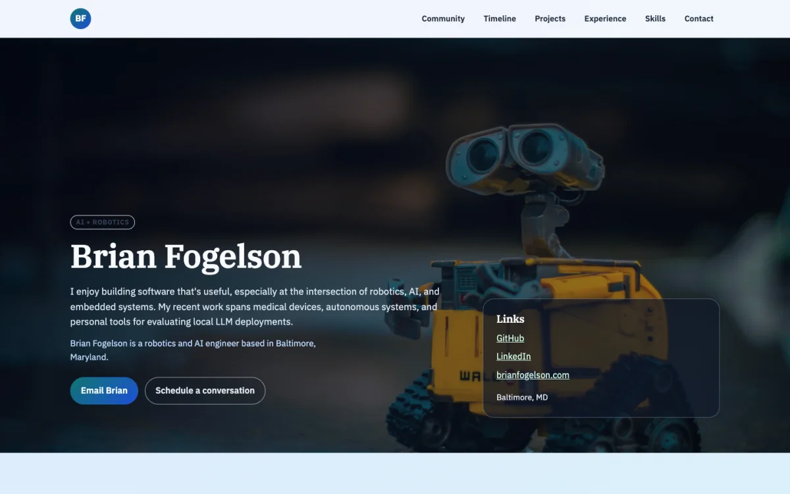

# Brian Fogelson's portfolio

The source for [brianfogelson.com](https://brianfogelson.com), a portfolio of
work across robotics, local AI, embedded systems, autonomy, and software
engineering.



## Design goals

- Make the work understandable without requiring a JavaScript framework.
- Keep the runtime and attack surface small.
- Treat accessibility and reduced-motion support as baseline requirements.
- Keep professional claims specific enough to be useful without publishing
  confidential implementation details.
- Make correctness checks inexpensive enough to run before every change.

## Architecture

The site is deliberately simple: semantic HTML, one CSS file, and a small
progressive-enhancement script are served by Express. Express is retained for
deployment portability and explicit control over security headers; it does not
render templates or expose an application API.

The server provides a restrictive Content Security Policy, disables framework
identification, serves a branded 404 page, and applies a small cache window to
static assets. Images are stored as WebP to reduce transfer size without adding
a build step.

```text
.
├── .github/          # CI and dependency-update automation
├── docs/             # Repository documentation assets
├── public/           # Static HTML, CSS, JavaScript, and media
├── scripts/          # Repository-specific validation
├── test/             # Node integration tests for server behavior
└── index.js          # Minimal static server and security headers
```

## Local development

Use the Node version declared in `.nvmrc`:

```sh
nvm use
npm ci
npm start
```

The site is available at <http://localhost:3000>. Set `PORT` or `HOST` to
override the defaults.

## Quality gates

```sh
npm run check
npm audit --omit=dev --audit-level=high
```

`npm run check` verifies JavaScript syntax, public-file hygiene, local links,
structured data, page metadata, safe external-link attributes, server behavior,
security headers, and the custom 404 response. CI runs the same checks on every
pull request and push to `main`.

Browser QA should cover the home, about, projects, and 404 pages at desktop and
mobile widths, with reduced motion enabled at least once.

## Content and privacy

The repository intentionally contains public professional information. Private
job-search notes, local environment files, large videos, and generated
dependencies are excluded. Third-party image sources are recorded in
[`public/img/CREDITS.md`](public/img/CREDITS.md).

## License

The software source is available under the MIT License. Portfolio copy and media
are not licensed for reuse. See [`LICENSE.md`](LICENSE.md) for the precise
boundary.
